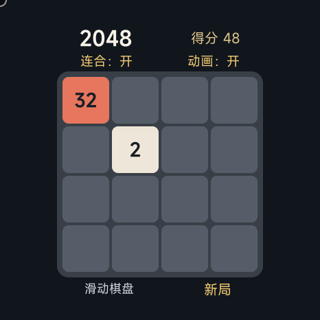

# XiaomiWatch-S4-APP

小米 Watch S4 应用。

## 2048 · 1.1.0

新增可关闭的轻量动画和可选的同方向连续合并：`16,8,8 → 16,16 → 32`。保留标准 2048 模式与旧版存档。

- [下载 1.1.0 RPK](releases/watch2048/1.1.0/com.sapnapboy.watch2048.debug.1.1.0.rpk)
- [源码与构建说明](apps/watch2048/README.md)
- [打包源码 ZIP](releases/watch2048/1.1.0/watch2048-1.1.0-source.zip)
- [使用说明](releases/watch2048/1.1.0/使用说明.md)
- [验证记录](releases/watch2048/1.1.0/验证记录.md)

动画仅在滑动时短时执行，固定复用方块并限制定时器数量；可点击“动画”关闭。模拟器测试不能代替真机温控验证。

